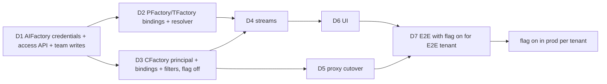

# Spec: show each user only their projects, with their role, in every portal

Revision 2 follows the Codex and agy spec reviews. Compared with the first
draft:

- **Service credentials** are now a separate, reserved type.
- **Projects are bound** explicitly across portals, instead of matched by
  repository name.
- **CFactory** gets a principal contract for every way in, and a full list
  of the data paths to filter.
- **Stream revocation** now has an absolute deadline.
- **Delivery order:** CFactory enforcement lands before the search proxies
  switch over.

## Approved intent decisions

1. **Today's AIFactory grant model stays exactly as it is.** Default-team
   projects inherit the org role. Other teams' projects need a team
   membership.
2. **One access page,** in AIFactory, linked from every portal.
3. **The other portals ask AIFactory** with the caller's identity. They
   cache for at most 60 s, fail closed (503) and never fall back to local
   tables.
4. **CFactory#575 is part of this work,** once CFactory knows who the user
   is.
5. **Who edits access:** org admins and owners for their org, and team
   admins for their own team.
6. **Edits change team membership,** and the page shows which projects each
   change affects.
7. **Unmapped CFactory items** are visible to org admins and owners only.

The intent also fixes these points:

- an invisible project returns 404, and a visible one with too low a role
  returns 403;
- AIFactory is the only permission store;
- service tokens and MCP keys keep their scoped behaviour;
- this work comes after the earlier #3857 phases;
- #575 lands before #574.

## Facts this design builds on

Taken from `origin/dev` on 2026-11-25, and checked by both reviews.

### Login and identity

- Each portal mints its own HS256 JWT, whose `sub` is that portal's local
  `User.id`.
- `users.oidc_sub` is the shared Keycloak subject in AIFactory, PFactory
  and TFactory.
- Local registration creates users with no `oidc_sub`.

### AIFactory keys and access helpers

- Any org member can create a personal `acw_` key and choose arbitrary
  scope strings. Personal keys with `api` scope authenticate as their owner.
- `ApiKey` cannot represent an ownerless key or a fleet-wide service key.
- `resolve_project_id("owner/repo")` can match a project by repository name
  alone, across owners and orgs.
- Deleting a default-team `TeamMembership` falls back to the org role. The
  next SSO login can recreate the row.
- The stream key and org re-check runs every **300 s**. Tagged events are
  checked on every delivery.

### PFactory and TFactory

Both still authorize with their local `OrgMember` table in places beyond the
two shared helpers:

- the TFactory DB-backed list and spec intake;
- PFactory project creation, unmatched-repo intake and plan sessions.

### CFactory

- **Browser path.** nginx replaces `Authorization` with a shared key and
  copies the incoming value into `X-Forwarded-Id-Token`. The Helm ingress
  can also send `/api` straight to the backend.
- **Audit verifier.** It falls back to the key actor when verification
  fails.
- **Key hand-out.** `/api/settings/token` and `/connect/vscode` hand out
  `preferred_key()` from the shared key pool.
- **Tenant.** It comes straight from `X-Tenant-Id`.
- **Project data.** `WorkItem` and cards carry no project id. Two writers
  feed them: `upsert_from_event` for webhooks and the WS relay, and
  `upsert_snapshot` for poll and refresh.

## Design

### D1. AIFactory: reserved service credentials and access reads

**A new `ServiceCredential` type** with its own table and its own `acs_`
prefix. It is not an `ApiKey`.

- **Owner:** none. A service credential belongs to no user.
- **Scopes:** `access:read`, `act-as`, and both.
- **Boundary:** one org, or an explicit `fleet: true` flag.
- **Who issues it:** only an org owner, or the instance owner for a fleet
  credential, through an admin route. The secret is shown once.
- **Audit:** every issue and every revoke is audited.
- **Reserved scopes:** personal and org `ApiKey` issuance and validation
  reject `access:read` and `act-as`.

**`GET /api/me/projects`** returns the caller's own projects, as
`[{project_id, slug, name, org_id, team_id, role, binding}]`.

- `binding` is the canonical repository identity:
  `{provider, host, owner, name}`.
- It also returns `orgs: [{org_id, role}]`, which decision 7 needs.

**`POST /api/access/resolve`** takes `{issuer, sub}` in the body, never in
the URL, so the subject stays out of URL logs.

- **Credential:** only an `acs_` credential with `access:read` may call it.
- **Subject:** the subject must be an active AIFactory user. An unknown,
  inactive or unprovisioned subject returns `[]`.
- **Computation:**
  1. grants are computed as **the target user's principal**, built
     separately from the credential;
  2. each returned grant is intersected with the credential's boundary,
     including for a subject who belongs to several orgs;
  3. the result has the same shape as `/me/projects`.
- **Audit:** credential id, subject hash, org, and the decision.

**Roles in every list.** `GET /api/projects` and `project_to_response` gain
`role` and `binding`.

**Team membership**, under decisions 5 and 6:

- list routes for teams and their members;
- `PUT` and `DELETE /api/teams/{team}/members/{user}`;
- `POST …/preview`, a dry run that returns, for each project, the
  effective role before and after the change, inherited roles included.
  The page shows that preview before it confirms.

**Default-team rule.** A default-team membership cannot restrict below the
org role. The preview says so, and points the admin to the org role
instead.

**SSO sync** only adds rows. It never overwrites or recreates a row marked
`provenance: "manual"`, including a deleted manual row, which is kept as a
tombstone.

**Allowed roles.** Assignments are limited to viewer, member and admin, and
may not exceed the editor's own role. The target must be a member of the
org.

### D2. PFactory and TFactory: explicit bindings and delegated resolution

**Binding.** Each local project stores `aifactory_project_id`.

- Existing projects are backfilled by matching the full canonical binding
  (provider, host, owner, name) against AIFactory's `/me/projects` bindings
  for an admin-scoped run.
- A unique match binds. An ambiguous match or no match leaves the project
  unbound and reports it.
- **New projects bind at creation.** They take an AIFactory project, or
  create one there through the existing onboarding, before the creator uses
  them.

**Visibility of a bound project** comes from the user's AIFactory grant on
`aifactory_project_id`.

**Unbound projects** are visible to local org owners and admins only
(decision 7). A missing grant on a bound project means hidden. The two cases
are never confused.

**Resolving the caller.** The caller is resolved from the authenticated
local user.

- **Human session:** `oidc_sub` together with the issuer goes to
  `/api/access/resolve` with the portal's `acs_` credential. The result is
  cached until an **absolute expiry**, the fetch time plus 60 s. On a
  timeout or a 5xx the request fails closed with 503.
- **Human with no `oidc_sub`:**
  - at login, link it by verified email to the AIFactory user's subject;
  - if that fails, the user sees no bound projects.

  The plan inventories these accounts before the switch.

**Keys and tokens keep their own identity.**

| Caller | Rule |
|---|---|
| A **user-owned key** | Resolves its owner's grants, clamped by the key's own scope and org ceiling |
| **Ownerless org keys, legacy tokens and TFactory's Copilot token** | Keep today's service behaviour on the routes that use them today: MCP, hand-offs and service feeds. A rule for a missing subject never touches them |

**One project-authorization helper** replaces every local `OrgMember`
check:

- TFactory's DB-backed list and spec intake;
- PFactory project creation, unmatched-repo intake and plan sessions.

A plan session with no project is visible to its creator and to org admins
only. The helper keeps the existing role thresholds, the local ids and the
404/403 meanings for every caller.

### D3. CFactory: principal contract, bindings and filters (#575)

**One principal per transport.**

| Transport | What CFactory accepts |
|---|---|
| **Browser HTTP and WebSocket** (through nginx) | nginx **strips** any client-supplied `X-Forwarded-Id-Token` and sets it only from oauth2-proxy's verified upstream header. The backend requires a valid ID token: verified issuer, required audience (`CFACTORY_OIDC_AUDIENCE` is mandatory in user mode), unexpired, non-empty `sub`. With a missing or invalid token it **refuses**, with no fallback to the key. The tenant comes from the principal's org, and `X-Tenant-Id` must match it |
| **Sibling proxies** | An `acs_` credential with `act-as`, plus `X-Acting-User: <issuer>|`. Allowed only on search and the needs-you count, as read |
| **Direct REST, editor and MCP** | Per-client keys. A key without `all-projects` sees nothing project-scoped |
| **Event producers** | Ingest keys only. No reads |

**Locking down the edges.**

- **Ingress:** the Helm ingress routes `/api` only through nginx in user
  mode, and a direct backend route is removed.
- **Key hand-out:** `/api/settings/token` and `/connect/vscode` issue a
  dedicated, read-only client credential for each user. Privileged keys
  (`act-as`, `all-projects`, write) are never in `preferred_key()`'s pool.

**Which projects the user can see** comes from AIFactory
`/api/access/resolve`, with CFactory's `acs_` credential. Each grant carries
an absolute expiry, and the request fails closed.

**Project binding on items.** `WorkItem` and cards gain `project_id`.

- **Source:** it is set by both writers (`upsert_from_event` and
  `upsert_snapshot`) from the trusted AIFactory task `projectId` that the
  adapter carries. It is never set from repository strings alone.
- **Cards:** a card takes its project when dispatched. Before dispatch it
  takes the tenant's bound default repository, and is marked
  `project_provisional`.
- **Conflicts:** once set, `project_id` changes only through an explicit
  rebind. A conflicting update keeps the old value and raises an anomaly.
- **Backfill:** a job resolves historical rows through AIFactory task
  lookups. Unresolved or ambiguous rows stay `project_id: null`, which is
  admin-only, and the job reports the count.

**Roles for CFactory actions:**

| Action | Minimum role |
|---|---|
| Reads | viewer |
| Card edits, comments, sync and import | member |
| Card stage actions (plan, code, test, run) and HITL `propose`/`execute` | member |
| Destructive actions (`delete_task`) | admin |
| The fleet-wide audit chain | org owner or admin |

**The filter runs before every read, aggregation, outbound call and
mutation**, on each of these:

- **Work items and their drill-downs:**
  - list and detail (404 when hidden);
  - timeline, process and evidence media;
  - worker progress, cost routing, and `/api/progress` with its in-memory
    hub;
  - tokens (including by worker), rollups, anomalies and cost.
- **Search and counts:** search and the needs-you count, filtered at the
  source before ranking and truncation.
- **Actions and history:** propose and execute, activity, audit and chain.
- **Copilot:** its board context and tools are built from the filtered
  store, never the process-wide one.
- **Cards:** list, detail, comments, sync-state, `PATCH`, `DELETE`, import,
  `sync-github` and stage actions.
- **Investigations:** context, runs, recovery and logs.
- **Live agents:** the list, and the console WebSocket proxy. The role
  check runs before any upstream service credential is used.
- **Git connections and repository metadata.**
- **MCP:** every tool, including detail, timeline, anomalies, card,
  investigation, git-config and action tools. The principal is carried into
  both MCP contexts.

**Rollout flag.** `CFACTORY_USER_AUTHZ` can be set per tenant
(`off`, `on`), plus a global default.

### D4. Streams: revocation within 60 s (all portals)

**Each connection holds its grants** with an absolute `expires_at`, the time
the grant was fetched plus 60 s.

- Before every frame is sent, an expired set is re-resolved.
- If renewal fails, the connection closes with an authz close code.
- When a project is revoked, the server drops any frames already queued for
  that project and sends a `revoked` control message, so the client clears
  its local state.

**Untagged events** (no project) are delivered only to the user they target.
Examples are GitHub authorization completion and personal notices. They are
never broadcast to the org.

**This applies to every stream:**

- **AIFactory:** `/ws/events`, its task and log sockets, terminal and rmux,
  and SSE.
- **PFactory and TFactory:** `/ws/events` (PFactory's gate is org-based
  today), and their log, progress, console and rmux sockets and SSE.
- **CFactory:** `/api/ws`, the REST-ingest and progress broadcasts (each
  gets a tenant and a project), `LiveProgress` (gains `project_id`), and
  the live-agent console.

AIFactory's 300 s key and org timer stays for the key checks. The grant
expiry above is added next to it.

### D5. Search and count proxies (AIFactory, PFactory, TFactory)

- The proxies send `act-as` plus `X-Acting-User` to CFactory.
- A failure upstream now returns an error to the UI (503). It is no longer
  turned into empty results or a zero count.
- A caller with no subject (a service key) gets a 403 from these
  user-facing routes.

### D6. Access page and roles in the switcher

**The AIFactory Access page.**

- **Admins** see a grid of users × projects × roles, grouped by team, and
  edit it through D1 with the preview shown first.
- **Everyone** sees "My access".
- **The other portals** link to it from their account menu.

**The shared `ProjectSwitcher`.** `SwitcherProject` gains an optional
`role`, shown as a badge. It is vendored to each portal with a
`HUB_PIN_SHA` bump.

### D7. E2E proof (Factory)

**Setup.** The owner creates the non-admin Keycloak test user. Projects V
and H are in the same tenant, under **different, non-default teams**. The
user is a member of V's team only.

**What must hold in all four portals, with `CFACTORY_USER_AUTHZ=on` for the
E2E tenant:** H must not appear in, or be served by, any of these:

- lists and the switcher;
- deep links (legacy and canonical, task and card ids), which return 404;
- search and the needs-you count;
- every stream, including queued frames;
- MCP;
- CFactory drill-downs, actions and Copilot.

V must work with the role `member`.

**Revocation.** Remove access just after a cache fill. V must disappear
within 60 s on active and idle connections, and stay gone after a reconnect.

**Default-team inheritance** is tested separately.

**Negative cases:**

- an `ApiKey` carrying a reserved scope;
- a personal key versus an ownerless key;
- cross-org delegation for a multi-org subject;
- an inactive subject;
- spoofed and conflicting principal headers;
- the editor hand-out returning only its dedicated credential;
- duplicate repository names across hosts and orgs;
- a hidden project versus an unbound one;
- a poll and event backfill race;
- an upstream 503 through the real search and count proxies.

## Order of delivery

- **#3857 phases.** This work starts after the earlier #3857 phases.
- **The proxy cutover (D5)** ships only once D3 is live, so search and the
  count never fall back to fleet-wide results.
- **Version skew.** Until D5 ships, the proxies keep today's behaviour.
- **Rollback.** Set `CFACTORY_USER_AUTHZ=off` for the tenant.

## Alternatives rejected

- **Forwarding portal JWTs, or one shared JWT secret.** That forges users
  across portals.
- **Matching by `owner/repo` at request time.** It collides across owners
  and hosts.
- **Using `ApiKey` with new scopes for delegation.** Members can mint those
  keys themselves.
- **Copying grants into each portal.** That is a second permission store.
- **The legacy shared token.** It is all-or-nothing.
- **Filtering only in the frontends.** The APIs stay open.

## Risks

- **The `acs_` credentials are powerful.**
  - Mitigation: they are reserved, ownerless, bound to an org (or flagged
    fleet), held only in the portals' control planes as sealed secrets, and
    audited on every call.
  - Remaining exposure: a compromised portal can resolve subjects only
    within its own boundary.
- **Fail-closed means an AIFactory outage blanks the other portals.** This
  is accepted (decision 3), with alerting.
- **Accounts with no `oidc_sub`.** The plan inventories them first and links
  them by email at login.
- **Unbound or unresolved items** go to admins only. The plan reports the
  counts.
- **Breadth.** This touches four repos, every stream and every CFactory
  route. The flag per tenant and a staged order limit the blast radius.
- **Hosts:** prod k3s through gitops only. No p510.

## Verification

- **Unit tests per repository** for every D item, including every negative
  case in D7.
- **CFactory:** a route-coverage test that enumerates the FastAPI routes and
  MCP tools and fails if any project-bearing one lacks the authz dependency.
- **Live:** D7 runs with the flag on for the E2E tenant, before the flag is
  turned on for any other tenant.
